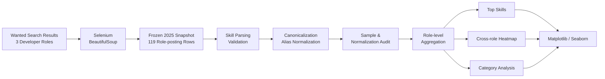

<div align="center">

# Developer Skill Analysis 📊

### Developer Job-posting Skill Analysis with a Frozen 2025 Wanted Snapshot

**Wanted 개발 직군 검색 결과를 수집하고  
기술명을 정규화한 뒤 직무별 요구 기술의 차이를  
재현 가능한 데이터 분석·시각화 파이프라인으로 비교합니다.**

<br/>

[](https://www.python.org/)
[](https://pandas.pydata.org/)
[](https://www.selenium.dev/)


[](https://github.com/tangerineYR/developer-skill-analysis/actions/workflows/analysis.yml)

<br/>

[📄Course Project Report (2025)](docs/historical-report-2025.pdf)
&nbsp;·&nbsp;
[📊 Analysis Summary](results/analysis_summary.json)
&nbsp;·&nbsp;
[🔍 Sample Audit](results/sample_audit.json)
&nbsp;·&nbsp;
[🧹 Normalization Audit](results/normalization_audit.csv)

</div>

---

## 📌 Overview

**Developer Skill Analysis**는 개발 직무를 준비하는 학생이 막연한 인식이 아니라 실제 채용공고 표본을 통해 직무별 기술 요구 차이를 파악할 수 있도록 수행한 데이터시각화 전공 프로젝트입니다.

2025년 Wanted에서 서버 개발자, 프론트엔드 개발자, 데이터 사이언티스트 검색 결과를 수집하고, 공고에 등장하는 기술명을 정규화해 직무별 기술 포함 비율과 기술 카테고리 구성을 비교했습니다.

```text
Wanted Job Search
        ↓
Selenium + BeautifulSoup
        ↓
Wanted Posting Snapshot (2025)
        ↓
Skill Parsing & Normalization
        ↓
Sample / Normalization Audit
        ↓
Role-level Aggregation
        ↓
Matplotlib / Seaborn Visualization
```

### Project Info

| 항목 | 내용 |
| --- | --- |
| **프로젝트 유형** | 데이터시각화 전공 프로젝트 · 개인 |
| **수행 시기** | 3학년 2학기 · 2025 |
| **데이터 소스** | Wanted 개발 직군 검색 결과 |
| **검색 조건** | `years=0` |
| **분석 직무** | 서버 · 프론트엔드 · 데이터 사이언티스트 |
| **Dataset Snapshot** | 119 role-posting rows |
| **고유 공고 Proxy** | 112 company-title pairs |
| **Data Collection** | Selenium · BeautifulSoup |
| **Analysis** | Pandas |
| **Visualization** | Matplotlib · Seaborn |
| **Validation** | 23 automated tests · GitHub Actions |

> **Dataset Scope**
>
> `wanted_jobs.csv`는 2025년 프로젝트 당시 생성한 frozen snapshot입니다.
>
> `years=0` 검색 조건을 사용했지만 일부 결과에는 `0~5년`, `~6년` 등 더 넓은 경력 범위를 명시한 제목도 포함되어 있으므로, 이 데이터를 **엄격한 경력 1년 미만 채용 집단으로 해석하지 않습니다.**
>
> 또한 표본 수를 전체 개발자 채용시장의 규모로 해석하지 않습니다.

---

# 🏗️ Analysis Pipeline



---

# 📦 Dataset Audit

분석에 사용한 `\wanted_jobs.csv`에는 총 **119개의 직무-공고 행(role-posting rows)**이 있습니다.

| Role | Rows |
| --- | ---: |
| **서버 개발자** | **44** |
| **프론트엔드 개발자** | **46** |
| **데이터 사이언티스트** | **29** |
| **Total** | **119** |

한 공고가 여러 Wanted 직무 검색 결과에 나타날 수 있기 때문에 row 수와 고유 공고 수는 동일하지 않습니다.

```text
119 role-posting rows
        ↓
112 unique company-title proxies
        ↓
7 proxies appear in multiple role queries
```

수집 당시 저장한 CSV에는 Wanted의 job ID와 공고 URL이 없으므로, `company + title` 조합은 **공고 identity의 proxy**로만 사용합니다.

또 제목 기준 heuristic에서 9개 row가 1년 이상의 경력 범위를 명시했습니다. 이 heuristic은 표본 감사용이며 row 삭제나 strict entry-level 판정에는 사용하지 않았습니다.

---

# 🧹 Skill Normalization

## Problem

채용공고에는 동일한 기술이 서로 다른 표기로 등장하며, 사전에 정의한 기술명 매핑에 포함되지 않은 기술도 존재합니다.

분석 대상 CSV에는 총 **503개의 원시 기술 언급(raw skill mentions)**이 있습니다. 등록된 별칭은 대표 기술명으로 통합하되, 매핑되지 않은 유효한 기술은 제거하지 않고 유지합니다.

예:

```text
Linux
Golang
Flutter
C#
Android
GraphQL
React Native
OpenCV
NLP
...
```

## Engineering Decision

현재 정규화 로직은 등록된 기술명의 별칭을 통합하고, 매핑되지 않은 유효한 기술도 보존하도록 설계했습니다.

```text
Known Alias
   ↓
Canonical Skill

Unknown Valid Skill
   ↓
Preserve Original Value
```

예:

```text
React.js       → React
GitHub         → Git
Tensorflow     → TensorFlow
C / C++        → C++
Golang         → Go

Unmapped Skill → 그대로 보존
```

한 공고 안에서 alias normalization 후 동일 기술이 중복되면 한 번만 집계합니다.

### Result

```text
Raw skill mentions               503
Canonical occurrences            495
Retained unmapped raw mentions    64
Silently dropped valid mentions    0
```

503 → 495의 차이는 기술 제거가 아니라 동일 row 안의 alias / duplicate canonicalization에 따른 중복 통합입니다.

세부 mapping은 [`results/normalization_audit.csv`](results/normalization_audit.csv)에서 확인할 수 있습니다.

---

# 📊 Snapshot Findings

## 1. Server Developer

서버 개발자 표본에서 가장 많이 등장한 기술은 다음과 같습니다.

| Skill | Posting-row Prevalence |
| --- | ---: |
| **AWS** | **36.4%** |
| **Java** | **36.4%** |
| Python | 29.5% |
| MySQL | 27.3% |
| Spring | 22.7% |
| Docker | 20.5% |

<p align="center">
  
</p>

Corrected taxonomy 기준으로 **서버 row의 54.5%에는 Cloud/Infra 기술이 하나 이상 포함**되어 있었습니다.

이는 전체 채용시장 추세를 의미하지는 않지만, 해당 표본에서는 application development뿐 아니라 AWS·Docker·Kubernetes 등의 인프라 관련 기술이 함께 등장하는 패턴을 보여줍니다.

---

## 2. Frontend Developer

| Skill | Posting-row Prevalence |
| --- | ---: |
| **React** | **71.7%** |
| **TypeScript** | **47.8%** |
| Next.js | 37.0% |
| JavaScript | 26.1% |
| Git | 23.9% |

<p align="center">
  
</p>

React와 TypeScript가 표본 내에서 높은 빈도로 나타났으며, 기술 occurrence 기준으로 **Framework/Library category가 42.9%**를 차지했습니다.

---

## 3. Data Scientist

| Skill | Posting-row Prevalence |
| --- | ---: |
| **Python** | **65.5%** |
| **PyTorch** | **44.8%** |
| **TensorFlow** | **31.0%** |
| SQL | 20.7% |
| Git | 13.8% |

<p align="center">
  
</p>

Python이 가장 넓게 나타났고 PyTorch와 TensorFlow가 뒤를 이어, 이 분석 표본에서는 머신러닝 프레임워크가 주요 기술군으로 나타났습니다.

---

# 🔥 Cross-role Comparison

각 셀은:

```text
해당 기술을 포함한 role-posting rows
──────────────────────────────────
해당 직무 전체 분석 rows
```

의 비율입니다.

<p align="center">
  
</p>

히트맵에서는 세 직무가 서로 다른 기술 생태계에 집중되는 패턴을 확인할 수 있습니다.

```text
Server
→ Java · AWS · Spring · MySQL

Frontend
→ React · TypeScript · Next.js

Data Science
→ Python · PyTorch · TensorFlow
```

이는 표본 내 기술 집중 패턴에 대한 관찰이며, 직무 간 기술 장벽을 통계적으로 입증한 결과로 해석하지 않습니다.

---

# 🧩 Two Different Category Metrics

카테고리 분석에서는 서로 다른 두 denominator를 명시적으로 구분합니다.

### 1. Skill Occurrence Composition

```text
category canonical skill occurrences
────────────────────────────────────
all canonical skill occurrences
```

직무별 합계가 100%가 되는 지표입니다.

### 2. Posting Prevalence

```text
rows containing ≥1 skill in category
────────────────────────────────────
all role rows
```

하나의 공고가 여러 category에 포함될 수 있으므로 합계가 100%일 필요가 없습니다.

대표적으로 서버 직무의 Cloud/Infra는:

```text
Occurrence Composition : 18.5%
Posting Prevalence      : 54.5%
```

입니다.

두 값을 혼용하지 않습니다.

<p align="center">
  
</p>

---

# 🚀 Engineering Highlights

## 1. Analysis Logic과 Visualization 분리

기존 `visualizer.py`에 섞여 있던 parsing, normalization, aggregation logic을 `analysis.py`로 분리했습니다.

```text
analysis.py
├─ skill parsing
├─ normalization
├─ category mapping
├─ sample audit
├─ skill frequency
├─ category metrics
└─ summary generation

visualizer.py
└─ plotting / artifact output
```

분석 함수를 plotting과 분리해 deterministic unit test가 가능하도록 변경했습니다.

---

## 2. Strict Input Validation

analysis.py의 parse_skill_list()는 기술 목록이 올바른 리스트 형식인지 확인하고, 문자열이 아닌 값이나 공백만 있는 기술명을 발견하면 행 번호와 함께 ValueError를 발생시킵니다.

현재는:

```text
Malformed list
Non-list value
Non-string skill
Blank skill
Missing required column
```

을 명시적인 validation error로 처리합니다.

분석 결과에서 잘못된 row가 조용히 사라지지 않도록 하기 위한 결정입니다.

---

## 3. Dataset Snapshot Integrity

scraper.py의 validate_output()은 분석용 데이터셋인 wanted_jobs.csv와 기존에 존재하는 출력 파일을 덮어쓰지 못하도록 검사합니다.

새로운 공고를 수집하려면 별도 출력 경로를 지정해야 합니다. 다음은 CLI 사용 형식이며, 현재 Wanted 웹페이지와의 호환성이 검증된 실행 예시는 아닙니다.

```powershell
python scraper.py --output scrape_output/wanted_jobs_new.csv
```

---

## 4. Collection Metadata

`scraper.py`는 수집에 성공한 공고를 저장할 때 다음 필드를 CSV에 기록하도록 구현돼 있습니다.

```text
source
query_role
posting_url
job_id
collected_at_utc
company
title
skills
```

분석 대상 `wanted_jobs.csv`에는 공고 URL이나 Wanted job ID가 저장되지 않았으므로 해당 정보를 임의로 복원하지 않습니다. 수집 스크립트의 CSS 선택자는 현재 Wanted 웹페이지에서 실시간으로 검증되지 않았으며, 사이트 구조 변경 시 작동하지 않을 수 있습니다.

---

# 🧪 Tests & CI

이 저장소에는 **23개의 자동화 테스트**가 있으며, 기술명 정규화, 집계 지표, 데이터셋 무결성, 스크레이퍼의 출력 경로 보호 및 URL 처리 등을 검증합니다. 실제 Wanted 웹페이지에 접속하는 live scraping 테스트는 포함하지 않습니다.

주요 검증 범위:

```text
Alias normalization
Unknown skill preservation
Within-row deduplication
Malformed skill rejection

119-row historical snapshot
44 / 46 / 29 role counts
112 company-title proxies
7 cross-role duplicates

Historical top-skill percentages
Category occurrence composition
Category posting prevalence
Normalization audit
Frozen snapshot integrity
```

실행:

```bash
python -m unittest discover -s tests -v
```

GitHub Actions에서는 Python 3.12 환경에서:

```text
Install dependencies
        ↓
Run 23 tests
        ↓
Run offline historical analysis
        ↓
Verify generated artifacts
        ↓
Verify frozen CSV integrity
```

를 수행합니다.

현재 `main` workflow는 통과합니다.

---

# ▶️ Reproduction

## Installation

```bash
git clone https://github.com/tangerineYR/developer-skill-analysis.git
cd developer-skill-analysis

python -m venv .venv
```

Linux / macOS:

```bash
source .venv/bin/activate
```

Windows:

```powershell
.\.venv\Scripts\Activate.ps1
```

의존성 설치:

```bash
pip install -r requirements.txt
```

## Reproduce Dataset Analysis

```bash
python visualizer.py --input wanted_jobs.csv --output-dir .
```

headless 실행이 기본이며, plotting window가 필요하면:

```bash
python visualizer.py --input wanted_jobs.csv --output-dir . --show
```

를 사용합니다.

---

# 📁 Project Structure

```text
developer-skill-analysis/
│
├── analysis.py                  # 기술 정규화·표본 감사·집계 로직
├── scraper.py                   # 선택적 채용공고 수집(실시간 호환성 미검증)
├── visualizer.py                # 분석 결과 시각화 및 artifact 생성
│
├── wanted_jobs.csv              # 2025년 Wanted 검색 결과 표본
├── requirements.txt
├── README.md
│
├── results/
│   ├── analysis_summary.json    # 핵심 분석 지표 및 denominator 정의
│   ├── sample_audit.json        # 표본 중복·경력 범위 heuristic 감사
│   ├── normalization_audit.csv  # raw → canonical 기술 정규화 기록
│   └── figures/
│       ├── graph_job_role_counts.png
│       ├── graph_skill_heatmap.png
│       ├── graph_skill_category_stacked.png
│       └── graph_top_skills_*.png
│
├── docs/
│   └── historical-report-2025.pdf
│
├── tests/
│   └── test_analysis.py
│
└── .github/
    └── workflows/
        └── analysis.yml
```

---

# 🔧 Engineering Decisions & Validation

| Concern | Engineering Decision | Verification |
|---|---|---|
| Dataset Integrity | Preserve the 119-row Wanted snapshot | Frozen CSV SHA-256 test |
| Sample Definition | Distinguish role-posting rows from unique company-title proxies | Sample audit |
| Role Overlap | Identify postings appearing in multiple role queries | Cross-role duplicate audit |
| Skill Aliases | Map equivalent skill names to canonical names | Alias normalization tests |
| Unmapped Skills | Preserve valid skills without predefined mappings | Unknown skill preservation tests |
| Duplicate Mentions | Count each canonical skill once per role-posting row | Deduplication tests |
| Input Quality | Reject malformed skill lists and missing required columns | Input validation tests |
| Metric Denominators | Separate skill occurrence composition from posting prevalence | Category metric tests |
| Dataset Protection | Prevent overwriting the frozen CSV | Scraper output validation tests |
| Reproducibility | Generate figures and structured results from the stored snapshot | Offline analysis CI |

The analysis reports descriptive patterns within the collected sample. It does not estimate the entire recruitment market or establish causal relationships.

---

# ⚠️ Scope & Limitations

**Dataset Snapshot**

이 데이터는 2025년에 수집한 Wanted 검색 결과 표본입니다. 정확한 수집 일시는 별도로 기록돼 있지 않으며, 현재 채용시장의 상태를 나타내지 않습니다.

**Not a Market Census**

119 rows는 전체 채용시장의 공고 수가 아니므로 직무별 시장 규모나 전체 수요를 추정하는 데 사용할 수 없습니다.

**Entry-level Scope**

검색에는 `years=0` 조건을 사용했지만 일부 공고 제목에는 더 넓은 경력 범위가 나타납니다. 따라서 strict `< 1 year` dataset으로 검증되지 않았습니다.

**Posting Identity**

분석 대상 CSV에는 posting URL과 Wanted job ID가 없어 `\company + title`을 공고 식별의 대체 기준(proxy)으로 사용합니다.

**Cross-role Overlap**

동일 proxy posting이 서로 다른 role query에 포함될 수 있으며 현재 snapshot에서는 7개가 확인됩니다.

**Skill-detection Selection**

수집 로직은 기술 스택을 하나 이상 탐지한 공고만 CSV에 기록하도록 구성돼 있습니다. 따라서 수집 결과는 Wanted 검색 결과 전체를 그대로 보존한 표본이 아닙니다.

**Scraper Compatibility**

스크레이퍼의 출력 파일 보호와 수집 메타데이터 저장은 코드에 구현돼 있지만, 현재 Wanted 웹페이지에서의 실시간 수집 성공 여부는 검증하지 않았습니다.

---

<div align="center">

**Collect → Normalize → Audit → Analyze → Visualize**

_Data analysis is only useful when the denominator, sample scope, and information loss are explicit._

</div>
